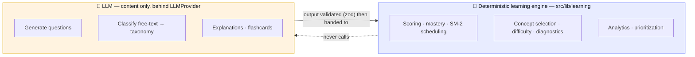
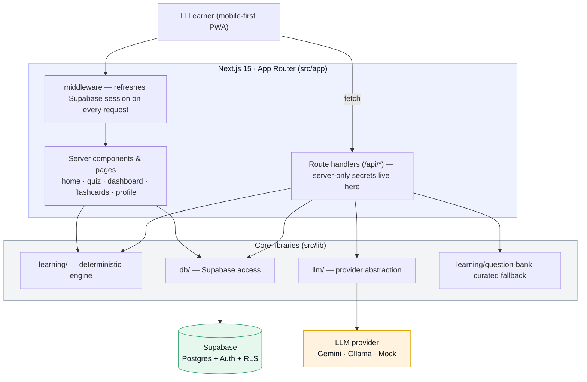
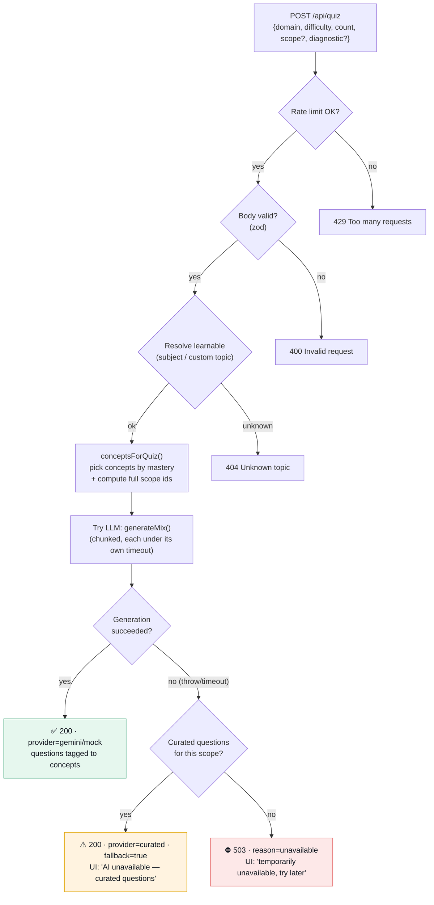
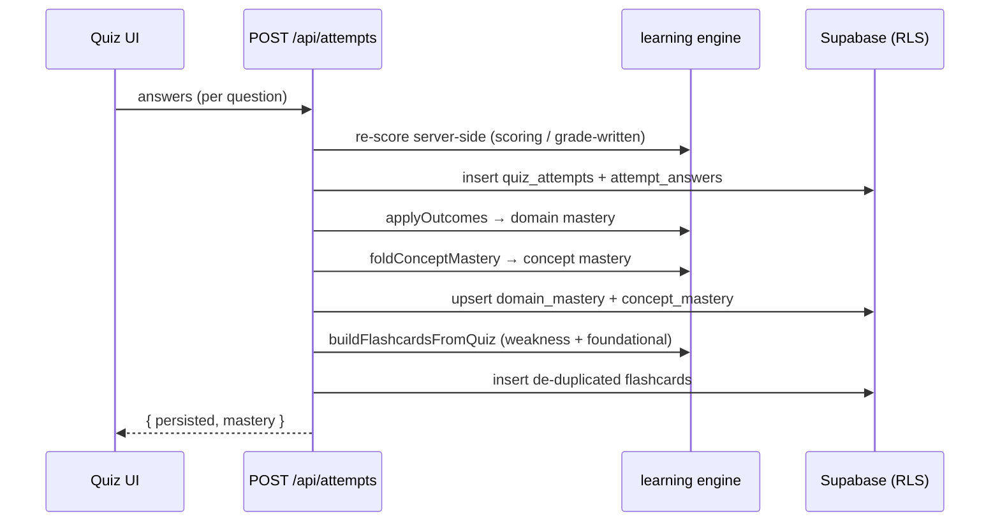
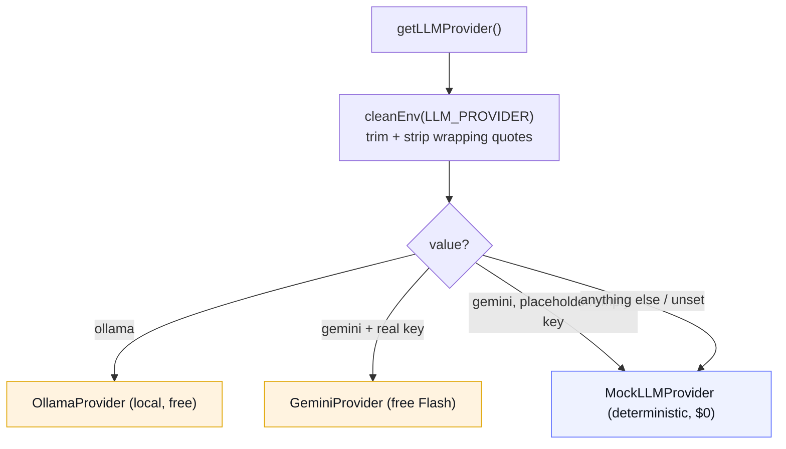
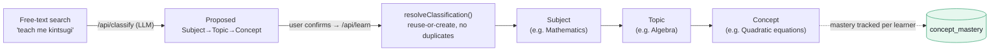
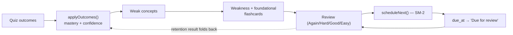
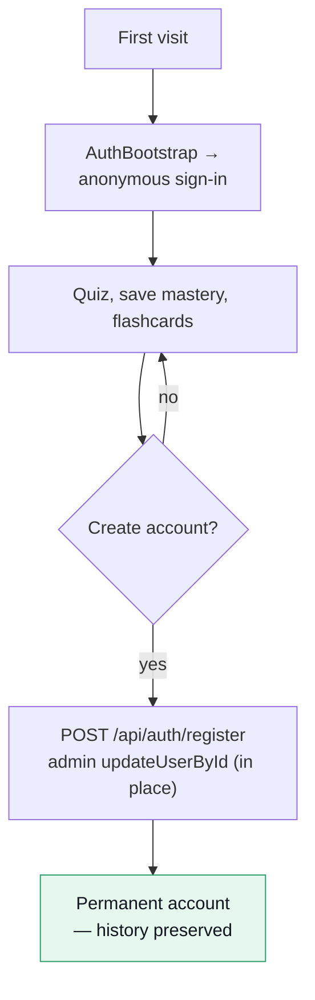
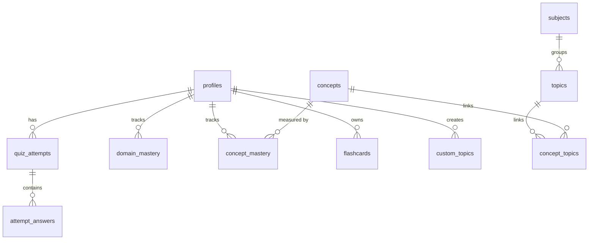
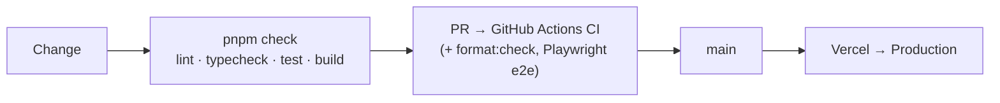

# Knowra — Architecture & Flows

A visual guide to how Knowra is put together and how a request moves through it. Diagrams use
[Mermaid](https://mermaid.js.org/) (GitHub renders them inline). Start here, then dive into the
code with the file pointers in each section.

- **Conventions & golden rules:** [`CLAUDE.md`](../CLAUDE.md)
- **Feature status:** [`FEATURES.md`](../FEATURES.md)
- **Decision log:** [`docs/ai-log.md`](./ai-log.md)
- **Design language:** [`docs/design.md`](./design.md)
- **Deploy & env:** [`docs/deployment.md`](./deployment.md)

---

## 1. The one big idea

Knowra separates **_knowing how well you know something_** from **_generating things to learn
from_**. The first is a deterministic, unit-tested TypeScript engine. The second is the only place
an LLM is used, hidden behind one interface.

**Why it matters:** the engine stays correct and testable no matter which model (or no model) is
configured, and all model output is treated as **untrusted** — validated with zod before it is
stored or rendered. See [`CLAUDE.md`](../CLAUDE.md) → _Golden rules_.

---

## 2. System at a glance

| Layer           | Where                             | Responsibility                                               |
| --------------- | --------------------------------- | ------------------------------------------------------------ |
| UI              | `src/app`, `src/components`       | Pages, quiz UI, dashboards; shadcn/ui primitives in `ui/`    |
| API             | `src/app/api/*`                   | Validate input, run the engine, call the LLM, read/write DB  |
| Learning engine | `src/lib/learning`                | All scoring/mastery/scheduling/selection — **no LLM, no DB** |
| LLM abstraction | `src/lib/llm`                     | `LLMProvider` interface + Gemini / Ollama / Mock backends    |
| Data            | `src/lib/db`                      | Supabase clients (user-scoped + admin) and typed queries     |
| Curated bank    | `src/lib/learning/question-bank*` | Hand-authored fallback questions, keyed to concepts          |

---

## 3. The headline flow — generating a quiz

Knowra is **LLM-first**: it always tries to generate fresh, personalized questions. When the model
is down, it degrades honestly — curated questions for covered content, or a clear "try again later"
otherwise. It **never** shows unrelated placeholder questions.

**Key points**

- **Covered vs. not:** the curated bank ([`question-bank-data.ts`](../src/lib/learning/question-bank-data.ts))
  covers a representative set of concepts (Math, Science, CS). The fallback draws from the **whole
  requested scope**, not just the LLM-selected subset — so a Math quiz falls back to curated Math
  questions. Custom/unseeded content has no curated entry, so it hits the 503 path.
- **Personalization** (from the 2nd quiz on) happens in `conceptsForQuiz` → `selectConceptsForQuiz`,
  which weights weak / unassessed / retention-due concepts using the learner's stored mastery.
- Code: [`src/app/api/quiz/route.ts`](../src/app/api/quiz/route.ts),
  [`src/lib/learning/question-bank.ts`](../src/lib/learning/question-bank.ts),
  [`src/components/quiz-session.tsx`](../src/components/quiz-session.tsx) (client states + notices).

### Scoring an attempt (the feedback loop)

Scores are **always recomputed on the server** from the answer key — the client is never trusted.
Code: [`src/app/api/attempts/route.ts`](../src/app/api/attempts/route.ts).

---

## 4. Choosing the LLM provider

Provider selection is **purely environment-driven** — it takes no user/auth input, so authenticated
and anonymous users get the same provider. Values are normalized so a dashboard-entered `"gemini"`
(with quotes) still matches.

- All three implement the same `LLMProvider` interface
  ([`src/lib/llm/provider.ts`](../src/lib/llm/provider.ts)); the rest of the app is identical
  regardless of backend.
- **Diagnose config live** without leaking secrets: `GET /api/health` reports the resolved provider,
  the raw shape of `LLM_PROVIDER` (so quotes/whitespace are visible), whether a key is present, and
  its length. Code: [`src/app/api/health/route.ts`](../src/app/api/health/route.ts).
- When the model fails for new content, `/api/classify` returns `503 { reason: "unavailable" }`
  (there is no curated equivalent for brand-new topics), and the UI asks the user to retry later.

---

## 5. Taxonomy & how content grows

Everything quizzable lives in a three-level taxonomy. A shared seed ships in code
([`src/lib/taxonomy/seed.ts`](../src/lib/taxonomy/seed.ts)); it expands as learners explore, without
duplicates.

Quizzes can run at **any level** — a whole subject, one topic, or a single concept — and every
generated question is tagged back to a concept so mastery rolls up the hierarchy.

---

## 6. Mastery & spaced repetition (deterministic)

Two small, pure engines do the "learning science":

- **Mastery** ([`mastery.ts`](../src/lib/learning/mastery.ts), [`aggregate.ts`](../src/lib/learning/aggregate.ts)):
  folds each outcome into a 0–1 mastery + confidence per concept/domain; surfaced as _X/10_.
- **SM-2 scheduling** ([`sm2.ts`](../src/lib/learning/sm2.ts)): Again/Hard/Good/Easy → next interval
  and due date for each flashcard.

---

## 7. Auth, sessions & data isolation

Knowra has **no login wall**: the first visit silently gets an anonymous Supabase session, so
progress is saved immediately. Signing up **upgrades the anonymous user in place**, keeping all
history.

- Every user table has **Row Level Security** — queries run as the signed-in user (anon key +
  session cookie), so one learner can never read another's rows.
- The **service-role** client ([`db/admin.ts`](../src/lib/db/admin.ts)) bypasses RLS and is used
  only for trusted server operations (seeding the shared taxonomy, in-place account upgrade). Its
  key is server-only and never reaches the browser.
- `/api/auth/register` auto-confirms accounts via the admin client to avoid the free-tier SMTP rate
  limit. See [`docs/ai-log.md`](./ai-log.md) (Phase 8).

---

## 8. Data model

- **Per-user (RLS):** `profiles`, `quiz_attempts`, `attempt_answers`, `domain_mastery`,
  `concept_mastery`, `flashcards`, `custom_topics`.
- **Shared catalog:** `subjects`, `topics`, `concepts`, `concept_topics` (many-to-many so a concept
  can belong to several topics).
- Schema is versioned in [`supabase/migrations`](../supabase/migrations) (`0001`–`0011`), each with
  its RLS policies.

---

## 9. Reliability & UX details

- **Structured logging** ([`src/lib/log.ts`](../src/lib/log.ts)): one JSON line per event in
  production (searchable in Vercel Runtime Logs), human-readable in dev. Levels INFO/WARN/ERROR;
  context is **redacted** (tokens, keys, emails masked) so secrets never land in logs.
- **Graceful degradation everywhere:** no Supabase keys → app still runs on the mock provider; LLM
  down → curated fallback or honest 503; DB write fails → logged, never a blank screen.
- **No "stuck" navigation:** `loading.tsx` skeletons for home, dashboard, flashcards, profile and
  quiz setup render instantly during server navigation, so pressing a subject never looks frozen.

---

## 10. Quality gates

- **Tests:** Vitest (unit + integration) in `tests/`, Playwright e2e in `tests/e2e`. The
  deterministic engine and the curated bank are fully unit-tested; API routes have integration
  tests (including the LLM-failure → curated / 503 paths).
- **CI** runs lint, typecheck, tests, `format:check`, build, and e2e on every PR.
- **Deploy:** Vercel via Git integration — see [`docs/deployment.md`](./deployment.md).
